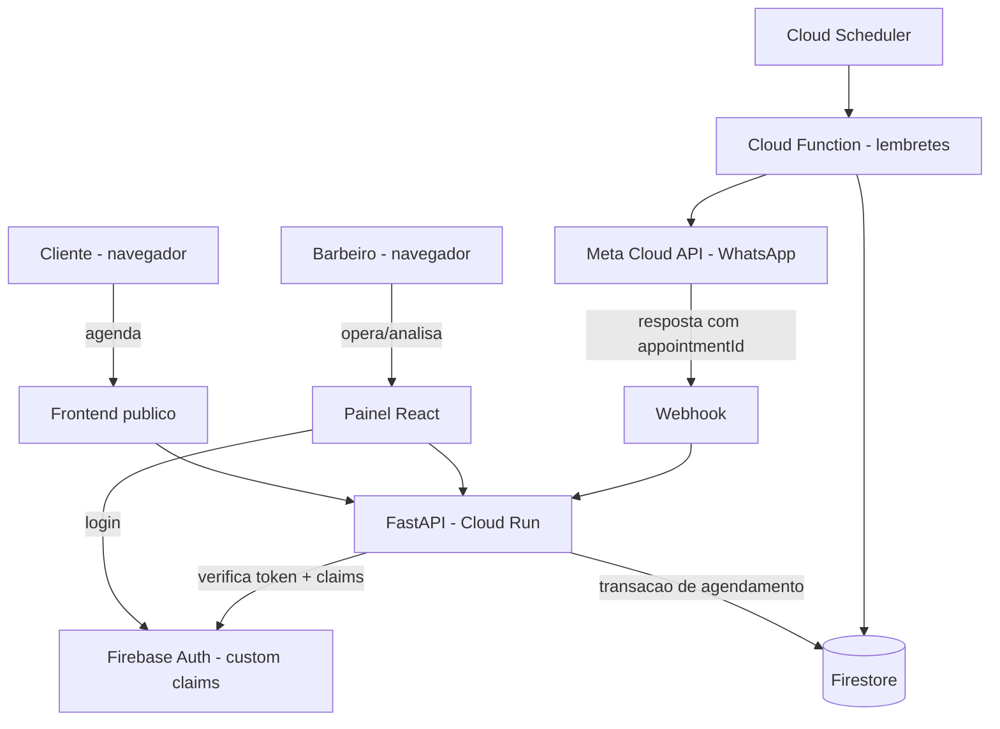

# Navalha — Documento de Especificação de Software

| | |
|---|---|
| **Produto** | Navalha (nome de trabalho) |
| **Versão** | 2.3 |
| **Data** | 11/11/2026 |
| **Autor** | Patrick |
| **Status** | Rascunho revisado — base para o MVP |

Documentos complementares: `CLAUDE.md` (contexto operacional e invariantes para o Claude Code) e `ROADMAP.md` (execução em fases). Este documento é a referência de produto e arquitetura; em caso de conflito, esta especificação prevalece sobre decisões pontuais.

> **Nota da v2.0.** Esta versão corrige lacunas identificadas em revisão técnica da v1.0, sobretudo na fronteira entre o que o produto afirma e o que o Firestore/serverless obriga na prática. As mudanças com maior impacto a jusante estão em: integridade da agenda (agora tratada como problema de concorrência, não só de cálculo), isolamento do `clients` entre tenants, vínculo de identidade de login ↔ barbearia, estratégia de consulta do analytics, e agrupamento por fuso local. Um resumo das alterações está na seção 16.

---

## 1. Visão geral

O Navalha é um **SaaS de agendamento e gestão para barbearias**. Resolve duas dores concretas do dono de barbearia: (1) a agenda no caderno/WhatsApp manual e os furos de horário (no-show), e (2) a total falta de visão sobre o próprio negócio — faturamento, lucro, horários de pico e comportamento dos clientes.

A proposta de valor não está no agendamento em si (que é commodity), mas no **painel de gestão com dashboard analítico**: é isso que transforma a ferramenta de "mais uma agenda" em algo pelo qual o barbeiro paga mensalidade.

O modelo é **híbrido**: o cliente agenda por um link web com calendário visual, e o WhatsApp entra apenas como canal de lembrete/confirmação — onde ele é mais eficaz (anti no-show) e mais barato.

## 2. Objetivos

- **Negócio:** validar um SaaS de nicho com receita recorrente, começando por uma barbearia-cobaia e expandindo por indicação regional.
- **Portfólio:** demonstrar arquitetura serverless multi-tenant, integração de terceiros (WhatsApp) e um módulo de analytics real — não um CRUD básico.
- **Produto:** entregar em semanas um MVP utilizável, priorizando o fluxo que gera valor imediato antes dos recursos avançados.

## 3. Escopo

### 3.1. Dentro do MVP

- Agendamento público via web, sem app e sem senha para o cliente.
- Painel web autenticado para o dono/barbeiro: agenda e operação diária.
- Dashboard de analytics com filtros cruzáveis.
- Controle manual de gastos e cálculo de lucro real.
- Lembretes de agendamento via WhatsApp (fase final do MVP).
- Suporte a múltiplos barbeiros por estabelecimento.

### 3.2. Fora do MVP (backlog)

- Cadastro self-service de novas barbearias (inicialmente feito manualmente pelo operador).
- Cobrança/assinatura automatizada (gateway de pagamento).
- Múltiplas unidades por dono.
- Aplicativo móvel dedicado / PWA.
- Pré-agregação de métricas para alto volume.

## 4. Personas

- **Dono da barbearia (usuário principal):** opera a agenda e consome o dashboard. Não é técnico. Quer clareza sobre quanto ganha, quando enche e quem sumiu.
- **Barbeiro (quando há vários):** vê a própria agenda e desempenho.
- **Cliente final:** só quer marcar horário rápido, sem cadastro. Interage pelo link e, depois, pelo lembrete no WhatsApp.

## 5. Requisitos funcionais

**Agendamento (cliente)**
- RF01 — Acessar a página de uma barbearia por link público (`/{slug}`).
- RF02 — Escolher serviço, barbeiro, data e horário a partir dos horários **realmente disponíveis**. A disponibilidade é calculada considerando a **duração do serviço escolhido** contra os agendamentos existentes do barbeiro (ver §7.1), e **exclui** agendamentos com status `canceled` (que reabrem o horário).
- RF03 — Confirmar informando nome e telefone, sem criar senha.
- RF04 — Receber confirmação do agendamento.
- RF04a — Escolher "qualquer barbeiro": o sistema oferece a união dos horários livres e atribui, no momento da gravação, o barbeiro livre com menos agendamentos no dia.
- RF04b — **Meus horários:** consultar pelo telefone os agendamentos futuros e as últimas visitas; **remarcar** (troca atômica, ver §7.1) e **cancelar** até `cancelMinHours` antes do horário (configurável; padrão 2h). Fora do prazo, mostrar o WhatsApp da barbearia.
- RF04c — **Repetir** o último serviço com o mesmo barbeiro em um toque.
- RF04d — **Apagar meus dados** (LGPD): cancela horários futuros, anonimiza nome/telefone nos agendamentos, remove o `client` e a conta.
- RF04e — **Perfil do cliente com telefone + senha** (opcional; agendar continua sem senha). Primeiro acesso: telefone, nome, senha (mínimo 8 caracteres) e aceite da política. Se o telefone já tem histórico, o perfil é ativado com esse histórico. O perfil mostra próximos horários (remarcar/cancelar), histórico, "seu de sempre" (repetir em um toque), nome, **recado para o barbeiro** (aparece na agenda da equipe), troca de senha, sair e apagar dados. Sessão fica salva no aparelho. **Esqueci a senha:** o cliente chama a barbearia pelo WhatsApp e o gerente usa "Liberar nova senha" na ficha do cliente; o cliente cria outra em "Primeiro acesso". Custo zero.

**Operação (barbeiro/dono)**
- RF05 — Autenticar-se no painel. A sessão carrega o `barbershopId` e o papel (`owner`/`barber`) do usuário (ver §12).
- RF06 — Visualizar a agenda por dia e por semana. Um `barber` vê a própria agenda; um `owner` vê a de todos os barbeiros do estabelecimento.
- RF07 — Marcar agendamentos como concluído, no-show ou cancelado.
- RF08 — Criar agendamento manualmente (cliente que ligou ou chegou sem marcar). Passa pela mesma validação transacional de disponibilidade do RF02.
- RF09 — Cadastrar e editar serviços (nome, preço, duração) e barbeiros.
- RF10 — Configurar horário de funcionamento da casa.
- RF10a — Configurar **horário próprio por barbeiro** (sobrepõe o da casa).
- RF10b — Barbeiro cria **bloqueios** (algumas horas, dia inteiro ou vários dias, com motivo). O link público deixa de oferecer o período na hora; agendamentos já existentes no período são listados com atalho para avisar o cliente pelo WhatsApp.
- RF10c — **Anotações por cliente** (preferências de corte, alergias), visíveis a toda a equipe.

**Gestão financeira**
- RF11 — Lançar gastos manualmente (descrição, valor, categoria, data).
- RF12 — Visualizar faturamento e lucro por período. **Lucro = faturamento − comissões − gastos.**
- RF12a — **Comissão por barbeiro** (% configurável), gravada no agendamento (`commissionPct`); "comissão a pagar" por barbeiro e período.
- RF12b — Configuração "barbeiro vê faturamento": se desligada, o barbeiro vê só a própria comissão.

**Dashboard analítico**
- RF13 — Ver KPIs consolidados: nº de agendamentos, faturamento, lucro, ticket médio, clientes únicos, taxa de no-show.
- RF14 — Ver ocupação por dia da semana × faixa de horário (heatmap de picos), agrupada no **fuso horário da barbearia** (ver §10).
- RF15 — Ver ranking de serviços por volume e por receita, usando o **nome do serviço congelado no agendamento** (resistente a renomeação/remoção posterior).
- RF16 — Ver clientes novos vs recorrentes e a lista de clientes inativos ("sumidos"). Definições fixadas em §10. Cada inativo tem atalho **"Chamar de volta"** (link `wa.me` com convite pronto, custo zero).
- RF17 — Aplicar filtros combinados (período, barbeiro, serviço, dia da semana, status) que recalculam todas as métricas. Estratégia de consulta especificada em §10.

**WhatsApp**
- RF18a — **(Fases 3–5, modo gratuito)** Listar no painel os agendamentos de hoje e amanhã sem lembrete e gerar, para cada um, um link `wa.me` com a mensagem pronta. O barbeiro envia pelo WhatsApp da barbearia e marca no painel a resposta do cliente (confirmou / pediu remarcar). Detalhes em §11.1.
- RF18 — **(Fase 6)** Enviar lembrete automático dos agendamentos das próximas 24h. O disparo cobre também agendamentos criados no mesmo dia após o job diário rodar (ver §11 e §12).
- RF19 — Processar a resposta do cliente (confirmar/remarcar) e atualizar **o agendamento correto**, correlacionado por `appointmentId` transportado no payload do botão de resposta rápida (ver §11).
- RF20 — (Opcional) Disparar mensagem de reativação para clientes inativos.

## 6. Requisitos não-funcionais

- **RNF01 — Isolamento (multi-tenancy):** dados de uma barbearia nunca acessíveis por outra. Todo registro carrega `barbershopId`, toda consulta filtra por ele, **e todo ID de cliente é escopado ao tenant** (§9). No painel, o `barbershopId` do requisitante vem do token autenticado, não de parâmetro do cliente.
- **RNF02 — Baixo custo operacional:** infraestrutura serverless que escala a zero; custo de WhatsApp mantido na categoria mais barata (utilidade/serviço).
- **RNF03 — Integridade da agenda (concorrência):** não pode existir agendamento sobreposto para o mesmo barbeiro. Esta é uma garantia de **concorrência**, não apenas de cálculo: a gravação ocorre dentro de uma **transação** que relê os agendamentos do barbeiro no intervalo e aborta em caso de conflito (ver §7.1). Testar a lógica de sobreposição não é suficiente — o risco está na janela entre ler e escrever.
- **RNF04 — Simplicidade de uso:** o cliente marca em poucos toques; o dono entende o dashboard sem treinamento.
- **RNF05 — Segurança:** rotas do painel protegidas por autenticação; segredos fora do repositório; sem dados sensíveis em URL. Endpoints públicos de agendamento têm proteção mínima contra abuso (§14).
- **RNF07 — LGPD:** consentimento explícito no agendamento público e na criação do perfil (lembrete por WhatsApp + política de privacidade), registro de `consentAt`, direito de exclusão (RF04d).
- **RNF06 — Fuso horário:** datas persistidas em **UTC**, exibidas e **agregadas** no fuso da barbearia. Todo agrupamento por dia-da-semana ou faixa de horário converte para o fuso local **antes** de bucketizar.

## 7. Arquitetura

Aplicação serverless na Google Cloud, com backend em API e dois front-ends (público e painel) consumindo a mesma API.

**Fluxos principais:**
1. **Agendar:** cliente → frontend público → API calcula disponibilidade → grava agendamento **dentro de uma transação** que revalida a ausência de conflito.
2. **Operar/analisar:** barbeiro autentica no painel → API verifica token e extrai `barbershopId`/`role` das claims → serve agenda e endpoints de analytics calculados sob demanda a partir do Firestore.
3. **Lembrar:** Cloud Scheduler aciona uma function → busca agendamentos das próximas 24h → dispara template via Meta Cloud API com botões de resposta rápida contendo o `appointmentId` → resposta do cliente volta por webhook, é correlacionada pelo `appointmentId` e atualiza o agendamento.

### 7.1. Cálculo de disponibilidade e escrita transacional

Este é o ponto mais delicado do sistema e concentra o maior risco. Duas propriedades independentes precisam ser garantidas:

**(a) Correção do cálculo.** A sobreposição de dois intervalos é `startsAt < existingEnd AND endsAt > existingStart`. O Firestore **não** executa esse duplo range numa única query. A estratégia é: consultar os agendamentos do barbeiro no **dia** (filtro simples por `barberId` + range de `startsAt`), trazer o conjunto e computar a sobreposição **em memória** na API. Como `durationMin` varia por serviço, os horários **não** formam um grid fixo — a disponibilidade é **dinâmica**, dependente da duração do serviço pedido contra os buracos existentes.

> **Decisão de granularidade.** Os *horários de início* oferecidos ao cliente seguem um passo configurável por estabelecimento (padrão 30 min), mas a **validação de conflito** é sempre contra a duração real do serviço. Isso mantém a UI limpa sem abrir mão da correção (um serviço de 45 min iniciado às 14:00 bloqueia corretamente o início às 14:30).

**(b) Ausência de condição de corrida.** Consultar-e-depois-gravar em dois passos é um TOCTOU: dois clientes pedindo o mesmo slot simultaneamente passam ambos na checagem. A gravação **deve** ocorrer dentro de uma **transação do Firestore** que relê os agendamentos do barbeiro no intervalo-alvo e **aborta** se surgir conflito. Isso vale igualmente para o agendamento manual do painel (RF08).

**Janela e bloqueios (v2.2).** A janela do dia é `barbers.hours[weekday]` quando o barbeiro tem horário próprio, senão `barbershops.openingHours[weekday]`. Os `blocks` do barbeiro que tocam o dia entram na lista de ocupados como se fossem agendamentos. A consulta de bloqueios filtra `start < fim_do_dia` no Firestore e completa `end > início_do_dia` em memória (um só campo de range por query).

**Remarcação atômica (v2.2).** Remarcar é uma operação única, na mesma transação: lê o agendamento antigo (precisa estar `scheduled`, ser do mesmo tenant e do mesmo telefone), ignora-o no cálculo de conflito (o cliente pode deslocar 30 min sobre o próprio horário), grava o novo e marca o antigo `canceled` com `cancelReason: remarcado` e `rescheduledTo`. Se o antigo estiver em outro dia ou barbeiro, a trava daquele dia também é escrita. Nunca existe o estado intermediário "dois horários" nem "nenhum horário".

**Status que bloqueiam o slot:** apenas `scheduled` e `completed` ocupam horário. `canceled` **reabre** o slot; `no_show` não reabre o passado, mas nunca bloqueia horários futuros.

## 8. Stack tecnológica

| Camada | Tecnologia |
|---|---|
| Backend / API | Python + FastAPI |
| Banco de dados | Firestore |
| Autenticação | Firebase Auth (com custom claims) |
| Hospedagem backend | Cloud Run |
| Agendamento de tarefas | Cloud Scheduler + Cloud Functions |
| Frontend | React + Vite |
| Gráficos | Recharts |
| Mensageria | Meta Cloud API (WhatsApp Business) |

Racional: casa com o domínio técnico do desenvolvedor (Python, Firebase, Google Cloud) e mantém o custo baixo via serverless.

## 9. Modelo de dados (Firestore)

Todas as coleções, exceto `barbershops`, carregam `barbershopId`.

| Coleção | Campos principais | Observações |
|---|---|---|
| `barbershops` | `name`, `slug`, `openingHours`, `timezone`, `phone`, `settings` | `slug` único globalmente; `settings` = `{cancelMinHours, inactiveDays, barberSeesRevenue}` |
| `barbers` | `barbershopId`, `name`, `active`, `uid`, `commissionPct`, `hours` | `uid` = usuário no Firebase Auth; `hours` = null usa o da casa |
| `blocks` | `barbershopId`, `barberId`, `start`, `end`, `reason`, `createdAt` | folgas e compromissos; ocupam horário |
| `services` | `barbershopId`, `name`, `price`, `durationMin` | |
| `clients` | id = `{barbershopId}_{phone}`; `barbershopId`, `phone`, `name`, `notes` (equipe), `clientNote` (recado do cliente), `authUid`, `accountAt`, `consentAt`, `createdAt` | ID composto isola o mesmo telefone entre tenants |
| `appointments` | `barbershopId`, `barberId`, `barberName`, `serviceId`, `serviceName`, `clientPhone`, `startsAt`, `endsAt`, `status`, `price`, `createdAt`, `updatedAt`, `reminder`, `commissionPct`, `cancelReason`, `rescheduledFrom`, `rescheduledTo` | ver snapshots abaixo; `reminder` = `{sentAt, channel: manual\|api, reply: confirmed\|reschedule\|null, repliedAt, sentBy}` |
| `expenses` | `barbershopId`, `description`, `amount`, `category`, `date` | |

- `appointments.status` ∈ `scheduled | completed | no_show | canceled`.
- **Snapshots congelados no ato do agendamento:** `price`, `serviceName` e `barberName` são **copiados** do serviço/barbeiro no momento da criação. O histórico não muda se o serviço mudar de preço, for renomeado ou removido, ou se o barbeiro sair. Isso mantém o analytics (RF15) íntegro sem exigir soft-delete e joins em memória.
- **Faturamento** = soma de `appointments.price` com `status = completed` no período.
- **Lucro** = faturamento − soma de `expenses.amount` no período.

### 9.1. Decisões de modelagem

- **Cliente sem senha, telefone como base do ID.** O ID é composto `{barbershopId}_{phone}` (coleção de topo), o que elimina cadastro/senha, conecta automaticamente o histórico para análise de frequência **e** preserva o isolamento entre tenants exigido pelo RNF01 — o mesmo número em duas barbearias vira dois documentos distintos. (Coleção de topo com ID composto foi preferida sobre subcoleção por barbearia porque simplifica as consultas do analytics.)
- **Identidade de login ↔ barbearia via custom claims.** No provisionamento manual de cada barbearia (que já está no escopo), o operador seta *custom claims* no usuário do Firebase Auth: `barbershopId` e `role` (`owner`/`barber`). A API extrai esses valores do token verificado — nunca de parâmetro enviado pelo cliente — e é assim que o RNF01 é aplicado no painel. Para o mapeamento barbeiro↔agenda, `barbers.uid` referencia o usuário correspondente.
- **`slug` único globalmente** e validado contra uma lista de paths reservados (`api`, `panel`, `admin`, `analytics`, etc.) para não colidir com rotas da aplicação.
- **Estrutura multi-barbeiro desde o início** evita refatoração quando a barbearia crescer, mesmo que a primeira tenha uma única cadeira.
- **`createdAt`/`updatedAt` em `appointments`** habilitam a lógica de "marcou no mesmo dia" (§11) e auxiliam debug/auditoria.

## 10. Especificação do dashboard

O dashboard é o diferencial competitivo. Deve permitir **cruzar dimensões livremente**.

**Métricas:** nº de agendamentos, faturamento, lucro, ticket médio, clientes únicos, taxa de retorno, taxa de no-show.

**Dimensões cruzáveis:** período (dia/semana/mês) × barbeiro × serviço × dia da semana × faixa de horário × status.

### 10.1. Estratégia de consulta (crítica para o RF17)

O Firestore não indexa dimensões derivadas: **dia-da-semana e faixa de horário não são campos queryáveis** — são derivados de `startsAt`. Combinar muitos filtros em query também esbarra em índices compostos por combinação. Dado o volume (centenas de agendamentos/mês por barbearia), a estratégia é deliberadamente simples:

> A **query ao Firestore filtra apenas `barbershopId` + range de data** (e, quando aplicável, `barberId`). Traz o conjunto do período. **Todo o resto do cruzamento** — serviço, dia-da-semana, faixa de horário, status — é filtrado e agregado **em memória, na API (Python)**. A query é "burra"; a inteligência está na agregação.

Isso confirma a decisão de **cálculo sob demanda, sem pré-agregação**, e a torna implementável dentro dos limites do Firestore. Pré-agregar só será reavaliado ao ultrapassar ~20 estabelecimentos.

### 10.2. Fuso horário no agrupamento

Datas são persistidas em UTC (RNF06). O heatmap (RF14) e qualquer filtro por dia-da-semana/faixa **convertem `startsAt` para o fuso da barbearia antes de bucketizar**. Ignorar isso é o bug de analytics mais comum com storage em UTC: um corte às 20h no horário local é 23h UTC — agrupando por hora UTC, o pico da noite vaza para o dia seguinte e some da faixa correta.

### 10.3. Definições fixadas

- **Cliente novo vs recorrente (RF16):** "novo" = cliente cujo `clients.createdAt` cai **dentro do período filtrado**; "recorrente" = já existia antes. (Alternativamente, novo = primeiro agendamento concluído no período — a definição escolhida é a baseada em `createdAt`, e deve ser mantida consistente.)
- **Cliente inativo/"sumido":** sem agendamento há mais de **X dias** (X configurável, padrão sugerido 60), calculado a partir do último `startsAt` com status `completed`.

- **Ocupação:** minutos de agendamentos `scheduled`+`completed` (até agora) ÷ minutos abertos dos barbeiros no escopo (janela − bloqueios). `no_show` não conta como ocupado, porque a cadeira ficou vazia.
- **Comparação:** cada KPI mostra a variação contra o período imediatamente anterior de mesmo tamanho.
- **Gastos com filtro:** gastos são da casa; quando há filtro de barbeiro, serviço ou dia da semana, o lucro não é exibido (só faturamento e comissões).

### 10.4. Endpoints de analytics

Sob `/analytics`, aceitando filtros como query params `from`, `to`, `barberId`, `serviceId`, `weekday`, `status`:

| Endpoint | Entrega |
|---|---|
| `/analytics/summary` | KPIs consolidados do período/filtro |
| `/analytics/heatmap` | Matriz dia-da-semana × faixa de horário (ocupação), em fuso local |
| `/analytics/services` | Ranking de serviços por volume e por receita (via `serviceName` congelado) |
| `/analytics/clients` | Novos vs recorrentes + lista de inativos (> X dias sem vir) |

**Insights de negócio que o dashboard habilita:**
- Slots mortos no heatmap → promoção direcionada para preencher.
- Lista de inativos → gatilho de reativação via WhatsApp.
- No-show por dia/cliente → decisão sobre confirmação obrigatória ou sinal.

## 11. Integração WhatsApp e modelo de custo

### 11.1. Modo gratuito — lembrete manual (validação, Fases 3–5)

Antes de qualquer integração paga, o lembrete funciona **sem API e sem custo**:

1. O painel mostra a fila de **hoje e amanhã**: agendamentos `scheduled` ainda sem `reminder`.
2. Cada item tem um botão que abre `https://wa.me/55DDDNUMERO?text=<mensagem codificada>`. O WhatsApp do aparelho (de preferência **WhatsApp Business**, app gratuito, no número da barbearia) abre com o texto pronto; o barbeiro aperta enviar.
3. Ao tocar no botão, o sistema grava `reminder = {sentAt, channel: "manual", sentBy}`. Não há como confirmar que a mensagem foi de fato enviada; o registro é declarativo.
4. A mensagem pede resposta em texto livre ("Responda SIM para confirmar ou REMARCAR"). Quando o cliente responde, o barbeiro marca `reply` no painel. Sem webhook, não há correlação automática.
5. As métricas de confirmação × no-show (§10) já funcionam com esses registros manuais, o que permite **medir o efeito do lembrete antes de pagar pela automação**.

Limitações aceitas: depende de disciplina do barbeiro; não há botões interativos; envio em lote é um por vez (abrir vários `wa.me` em sequência).

### 11.2. Modo automático — Meta Cloud API (Fase 6)

Cobrança **por mensagem entregue** desde 01/07/2025, variando por categoria e país. Regras vigentes (verificadas em nov/2026):

| Categoria | Quando é cobrada | Referência Brasil |
|---|---|---|
| Utilidade (template) | Sempre, **inclusive dentro da janela de 24h desde 01/10/2026** | ~US$ 0,0068 por mensagem |
| Serviço (resposta livre na janela de 24h) | **Desde 01/10/2026**, com **1.000 grátis/mês por número** | — |
| Marketing (template) | Sempre | mais cara; não usada no lembrete |
| Mensagem recebida do cliente | Nunca | grátis |

Desde 01/07/2026 a Meta fatura o Brasil em reais (BRL), via Facebook Brasil. Consultar a tabela oficial antes de precificar, pois os valores são revisados periodicamente.

**Impacto no Navalha:** cada lembrete é 1 mensagem de utilidade (~US$ 0,0068). Uma barbearia com ~400 agendamentos/mês gasta ~US$ 3/mês. As respostas automáticas ao Confirmar/Remarcar são mensagens de serviço e cabem na franquia de 1.000/mês. O custo segue marginal, mas **deixou de ser zero** dentro da janela (premissa da v2.0 corrigida).

**Correlação de respostas (RF19).** O webhook entrega o telefone do remetente, mas um cliente pode ter mais de um agendamento futuro — então "confirmar" seria ambíguo. O template de lembrete usa **botões de resposta rápida com payload** carregando o `appointmentId`; a resposta já chega correlacionada ao agendamento certo. Não se depende de heurística de "próximo agendamento".

**Cobertura de agendamentos do mesmo dia (RF18).** O job diário não cobre agendamentos criados **depois** de ele rodar. Mitigação: além do disparo diário, enviar o lembrete **no ato do agendamento** quando o horário marcado for para as próximas 24h (usando `createdAt` para não duplicar). Alternativa: rodar o Scheduler com maior frequência.

**Estratégia de canal:** validar com o **modo gratuito (§11.1)**, medindo confirmação e no-show. Para produção, usar a **API oficial (Meta Cloud API)** — estabilidade e ausência de risco de banimento. APIs não-oficiais só se admitem em teste controlado com número secundário, nunca em venda como "sistema profissional".

## 12. Autenticação e autorização

- Login do painel via **Firebase Auth**.
- Cada usuário carrega **custom claims**: `barbershopId` e `role` (`owner` | `barber`), setadas no provisionamento manual da barbearia.
- A API **verifica o token** em toda rota do painel e deriva o `barbershopId`/`role` **das claims**, nunca de parâmetro do requisitante. Esse é o mecanismo que aplica o RNF01 no painel.
- Autorização por papel: `owner` enxerga todos os barbeiros e o dashboard completo; `barber` enxerga a própria agenda e desempenho (`barbers.uid` faz o mapeamento).
- Endpoints públicos (`/{slug}`, disponibilidade, criar agendamento) **não** são autenticados — por design — mas têm proteção contra abuso (§14).

### 12.1. Conta do cliente (v2.3)

- Provedor: **Firebase Auth e-mail/senha**, com e-mail interno derivado do telefone (`5562999991234@clientes.navalha.app`). Sem custo por login; o Firebase guarda o hash da senha e limita tentativas.
- Uma identidade por telefone, válida para qualquer barbearia. O vínculo com cada barbearia é `clients/{barbershopId}_{phone}.authUid`; o perfil só lê dados da barbearia do link (RNF01).
- Token do cliente leva a claim `role: "client"` e o `phone`; a API só deixa o cliente ler/alterar agendamentos em que `clientPhone` = `phone` do token.
- "Liberar nova senha" (gerente) apaga a credencial do Firebase daquele telefone; o cliente refaz em "Primeiro acesso".

## 13. Roadmap (resumo)

Detalhamento e commits em `ROADMAP.md`.

| Fase | Entrega | Marco |
|---|---|---|
| 0 | Setup (repo, Firebase, esqueleto) | Ambiente rodando |
| 1 | Modelo de dados + CRUD + **disponibilidade transacional** | API funcional |
| 2 | Agendamento público (web) | Cliente marca horário |
| 3 | Painel + auth (claims) + agenda + **`/analytics/summary`** + **lembrete manual (wa.me)** | **Produto utilizável + fatia do diferencial** |
| 4 | Dashboard analítico completo (heatmap, serviços, clientes) | Diferencial no ar |
| 5 | Gastos + lucro | Visão financeira completa |
| 6 | WhatsApp automático via API oficial (lembretes + correlação) | Canal híbrido ativo |

> **Ajuste de validação (v2.0).** A tese do produto é "o barbeiro paga pelo **dashboard**", mas na v1.0 o ponto de validação (fim da Fase 3) entregava só a agenda — a commodity. A Fase 3 agora inclui uma **fatia fina do dashboard** (`/analytics/summary`: faturamento, lucro, ticket médio, no-show), para que a conversa de validação com a barbearia-cobaia já toque na coisa pela qual ela supostamente pagaria. O dashboard completo permanece na Fase 4, alimentado por dados reais.

## 14. Principais decisões de projeto

- **Modelo híbrido (web + WhatsApp) em vez de bot conversacional.** Um calendário visual oferece melhor experiência de escolha do que negociar horário por chat, e evita semanas polindo fluxo conversacional. O WhatsApp entra apenas onde agrega: notificação.
- **Disponibilidade dinâmica + escrita transacional.** Disponibilidade calculada em memória contra a duração real do serviço; gravação dentro de transação que revalida conflito. Correção e ausência de corrida tratadas como propriedades distintas (§7.1).
- **Analytics com query "burra" + agregação em memória.** Filtra `barbershopId` + range de data no Firestore; cruza o resto em Python. Adequado ao volume; respeita os limites do Firestore; evita complexidade prematura.
- **Multi-tenant e multi-barbeiro desde o início.** Barato de fazer agora, caro de refatorar depois.
- **Isolamento reforçado:** `barbershopId` em todo registro; `clients` com ID composto por tenant; `barbershopId` do painel derivado das claims do token.
- **Snapshots no agendamento** (`price`, `serviceName`, `barberName`): histórico de analytics íntegro a renomeações/remoções.
- **Cliente sem senha (telefone como base do ID).** Menos fricção e histórico automático.
- **Ordem de fases prioriza usabilidade cedo** — com uma fatia do diferencial antecipada para a validação bater na hipótese central.

## 15. Riscos

| Risco | Mitigação |
|---|---|
| **Concorrência na agenda** → dois clientes gravam o mesmo slot (TOCTOU) | Gravar **dentro de transação** que relê e aborta em conflito (§7.1); não confiar em "testar a lógica" |
| Cálculo de sobreposição incorreto (duração variável, status) | Overlap em memória contra `durationMin` real; excluir `canceled`; testar exaustivamente na Fase 1 |
| Vazamento entre tenants pelo `clients` | ID composto `{barbershopId}_{phone}`; toda query filtra `barbershopId` |
| Painel sem saber o tenant do requisitante | `barbershopId`/`role` via custom claims verificadas no token, nunca por parâmetro |
| Heatmap/faixas erradas por agrupar em UTC | Converter para fuso local **antes** de bucketizar (§10.2) |
| Analytics quebra quando serviço/barbeiro é renomeado ou removido | Snapshots `serviceName`/`barberName` no agendamento |
| **Abuso de endpoints públicos** (enumeração de agenda, injeção de agendamentos, spam de WhatsApp/custo pós-Fase 6) | Throttle por IP e/ou captcha leve no confirm; monitorar volume anômalo |
| Resposta de WhatsApp aplicada ao agendamento errado | Botões de resposta rápida com `appointmentId` no payload (§11) |
| Lembrete não cobre agendamento do mesmo dia | Disparar também no ato quando o horário for < 24h; ou aumentar frequência do Scheduler |
| Perfil com telefone + senha **sem verificar a posse do telefone**: alguém pode criar a senha no número de outra pessoa antes dela | **Risco aceito na validação** (decisão do Patrick, nov/2026). Mitigação: criar perfil em número que já tem senha é bloqueado; o dono do número pede "Liberar nova senha" à barbearia. Revisar ao abrir para outras barbearias: link de ativação no WhatsApp ou código (SMS US$ 0,02 / WhatsApp ~US$ 0,0068) |
| Tentativas de adivinhar senha | Firebase Auth limita tentativas; senha mínima de 8 caracteres |
| Bloqueio criado sobre horários já marcados | O sistema não cancela sozinho: lista os afetados com atalho de aviso pelo WhatsApp |
| Distribuição (achar quem paga) mais difícil que o código | Começar por barbearia-cobaia conhecida; crescer por indicação; validar com fatia do dashboard já na Fase 3 |
| Suporte manual consome tempo | Manter o produto simples e à prova de erro do usuário |
| Banimento em API não-oficial | Usar API oficial em produção |
| Barbeiro não lançar gastos → "lucro" vira só faturamento | UX simples de lançamento; deixar claro que lucro depende do input |

## 16. Backlog pós-MVP

Cadastro self-service de barbearias; cobrança/assinatura via gateway (Mercado Pago/Stripe); múltiplas unidades por dono; PWA para o barbeiro; pré-agregação de métricas; reativação automática por régua de tempo.

## 17. Histórico de versões

| Versão | Data | Alterações |
|---|---|---|
| 1.0 | 28/07/2026 | Versão inicial consolidada a partir das definições de produto e arquitetura |
| 2.0 | 28/07/2026 | Revisão técnica incorporada (ver detalhe abaixo) |
| 2.3 | 11/11/2026 | Perfil do cliente com telefone + senha (RF04e), recado do cliente para o barbeiro, liberar nova senha pelo gerente; risco de posse do telefone aceito na validação |
| 2.2 | 11/11/2026 | Autoatendimento do cliente (remarcar/cancelar/repetir/apagar dados), qualquer barbeiro, horário por barbeiro, bloqueios, comissão (snapshot) e lucro líquido, anotações de cliente, LGPD (RNF07), definição de ocupação, filtros cruzados + comparação com período anterior + heatmap no dashboard |
| 2.1 | 11/11/2026 | Lembrete manual gratuito via `wa.me` na validação (§11.1, RF18a, campo `reminder`); preços e regras da Meta atualizados (cobrança de utilidade e serviço dentro da janela desde 01/10/2026) |

**Detalhe das alterações 1.0 → 2.0:**
1. **Integridade da agenda** reescrita como problema de **concorrência**: RNF03 e nova §7.1 exigem escrita transacional; risco correspondente promovido no topo da tabela de riscos.
2. **Disponibilidade dinâmica** especificada: overlap contra `durationMin` real, granularidade de início configurável, status que bloqueiam/reabrem slot definidos (RF02).
3. **`clients` com ID composto** `{barbershopId}_{phone}` para não colidir entre tenants (RNF01, §9).
4. **Vínculo de login ↔ barbearia** via custom claims (`barbershopId`, `role`) + `barbers.uid`; nova §12; RF05/RF06 ajustados.
5. **Estratégia de consulta do analytics** explicitada (§10.1): query filtra só `barbershopId` + range de data, resto agregado em memória (RF17).
6. **Agrupamento em fuso local** antes de bucketizar (§10.2, RNF06, RF14).
7. **Snapshots** `serviceName` e `barberName` no agendamento, além de `price` (§9, RF15).
8. **Abuso de endpoints públicos** adicionado como risco com mitigação (RNF05, §14).
9. **Correlação de resposta do WhatsApp** por `appointmentId` no payload (RF19, §11).
10. **Cobertura de lembrete no mesmo dia** (RF18, §11); campos `createdAt`/`updatedAt` em `appointments`.
11. **`slug`** único global + paths reservados (§9.1).
12. **Definições** de novo/recorrente e de inativo fixadas (§10.3, RF16).
13. **Validação antecipa fatia do dashboard** para a Fase 3, alinhando o ponto de validação à tese do produto (§13).
